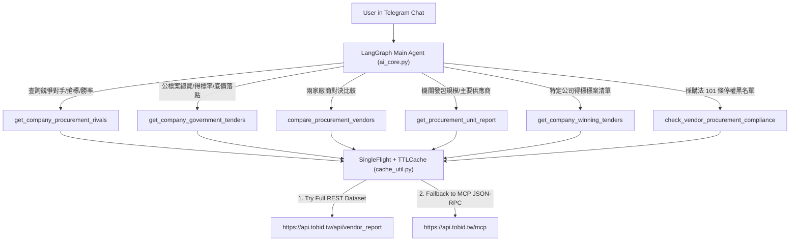

# Design: Advanced Taiwan Government Procurement Intelligence

## Architecture & Data Flow

## Hybrid Data Fetcher
- **Primary**: `https://api.tobid.tw/api/vendor_report?name={name}` with `Referer: https://tobid.tw/` and `Origin: https://tobid.tw`.
  - Provides full 15+ rivals with `win_rate_vs`, 20 top clients with shares, 10 recent losses with bid prices, reserve distribution (`r_ba`, `r_ab`, `r_pb`), and categories.
- **Fallback**: `_call_tobid_mcp("vendor_report", {"name": name})` via standard JSON-RPC 2.0.
  - Ensures 100% resilience if REST endpoint changes or throttles.
- **Normalization Layer**: Both sources map to a clean unified schema so formatting functions work consistently.

## Prompt Routing Rules in `ai_core.py`
Explicit routing keywords:
- "競爭對手", "搶標", "同場交手", "常輸給誰", "相對勝率", "落標": `get_company_procurement_rivals`
- "誰比較強", "對決", "誰得標多", "A vs B": `compare_procurement_vendors`
- "發包機關", "主要供應商", "發包給誰", "採購規模": `get_procurement_unit_report`
- "得標戰報", "得標率", "底價落點", "議價空間", "營收先行指標": `get_company_government_tenders`
- "得標案件清單", "最近拿到什麼標案": `get_company_winning_tenders`
- "停權", "黑名單", "拒絕往來", "第 101 條": `check_vendor_procurement_compliance`
